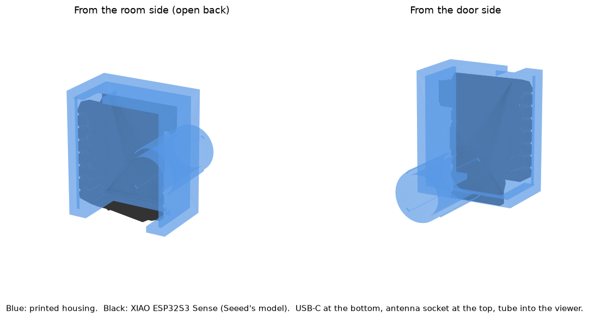

# Door unit

A housing for the whole XIAO ESP32S3 Sense, with a tube that slides into the door
viewer's inner bore. It films through the existing viewer, so the door isn't changed
and its fire rating isn't affected. The unit hangs from the tube on its own, with
nothing stuck to the door.

- **Back:** open. The board goes in from the back and snaps past two small lips.
- **Bottom:** USB-C plug, plus room for a microSD card.
- **Top:** a slot for the WiFi antenna's cable.
- **Front:** the camera's lens barrel sits in the tube's opening, which centres it.

Housing 24.8 × 20.9 × 13 mm, about 3 g of plastic. The tube is 10.1 mm across, with four
thin ribs that reach 10.6 mm. They crush slightly as it goes into the 10.5 mm bore, so it
grips without a fit test. It reaches 16 mm into the viewer, stopping 2 mm short of the glass.

The board's dimensions come from Seeed's 3D model of the XIAO ESP32S3 Sense. The model
was checked against it: no part of the board touches the plastic, with at least
0.2 mm to spare. The tightest spot is the lens barrel in the tube. Not printed or fit-tested yet.

## Print
Print `stl/housing.stl` with the open back on the bed. No supports: the front bridges
across. PETG or PLA, 0.12 mm layers, 0.4 mm nozzle, 100% infill (the walls are only
three lines thick anyway).

If the tube is too loose in the viewer, raise `rib_d` by 0.1 and print again. If it's
too tight, lower it.

The camera may differ slightly from Seeed's model, which shows the older OV2640. If
the board is tight, raise `gap`.

## Fit
- Slide the tube in and out while watching `http://door-cam.local/` until the picture
  is best, then rotate the unit to level the image.
- Clip the USB cable to the door just below the unit, so a tug on the cable can't pull
  the tube out.
- Point the antenna up, away from the door.

## Limits
The camera's square body is wider than the bore, so only the lens barrel enters the
tube. The lens can't get closer to the glass than the bore depth minus the barrel's
length, and sliding the tube out only moves it farther away.
